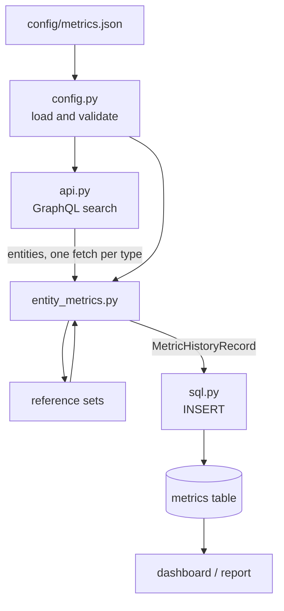

# CluedIn.DataQualityMetrics.Extension

**Scheduled data quality metrics for a CluedIn instance.**

This extension reads golden records out of CluedIn over GraphQL, scores them against
checks you declare in a configuration file, and writes one history record per metric
into a Microsoft SQL Server or Azure Synapse table. Point a dashboard at that table and
you have data quality trended over time.

Nothing about a particular instance is compiled in. Entity types, vocabulary keys,
validation rules, reference data, the target table and its column names are all
[parameters](#parameters). The same image serves any CluedIn instance; only the
configuration differs.

---

## Contents

- [At a glance](#at-a-glance)
- [How it works](#how-it-works)
- [Quick start](#quick-start)
- [Concepts](#concepts)
- [Configuration reference](#configuration-reference)
  - [Resolution order](#resolution-order)
  - [Top level](#top-level)
  - [`entity_types`](#entity_types)
  - [Checks](#checks)
  - [Rules](#rules)
  - [`reference_sets`](#reference_sets)
  - [`dynamic_metrics`](#dynamic_metrics)
  - [`sql`](#sql)
- [Configuration cookbook](#configuration-cookbook)
- [Parameters](#parameters)
  - [Environment variables](#environment-variables)
  - [Command line](#command-line)
  - [Make variables](#make-variables)
  - [Helm values](#helm-values)
- [The metrics table](#the-metrics-table)
- [Running locally](#running-locally)
- [Container image](#container-image)
- [Deploying to Kubernetes](#deploying-to-kubernetes)
- [Extending](#extending)
- [Operations](#operations)
- [Security](#security)
- [Troubleshooting](#troubleshooting)
- [Migrating from the hardcoded version](#migrating-from-the-hardcoded-version)
- [Repository layout](#repository-layout)
- [Scripts and notebooks](#scripts-and-notebooks)

---

## At a glance

```text
CluedIn (GraphQL search)  ->  configured checks  ->  SQL Server metrics table
```

| | |
|---|---|
| **Runs as** | A Kubernetes `CronJob`, hourly by default. Also runs fine as a one-off CLI. |
| **Reads** | Golden records, through the CluedIn search API. Read-only; it never writes to CluedIn. |
| **Writes** | One `INSERT` per metric per run, into one table. Append-only. |
| **Configured by** | One JSON file, mounted from a ConfigMap. No instance data in the image. |
| **Credentials** | Environment variables only, from a Kubernetes Secret. Never in the config file. |
| **Failure mode** | `restartPolicy: Never`, `backoffLimit: 1` — a bad run waits for the next schedule. |

---

## How it works



The run, step by step:

1. **Load and validate the configuration.** `config.py` parses the JSON, checks every
   required key, validates the SQL identifiers, and fails before contacting anything if
   a check names a rule option or a reference set that does not exist.
2. **Fetch the entities.** `api.py` builds a `cluedin.Context` from the `CLUEDIN_*`
   variables and pages through `search(query: "entityType:...")`. Every entity type the
   configuration mentions is fetched exactly once — including types used only as
   reference data, and types that appear in both roles.
3. **Build the reference sets.** Each named set collects the values one vocabulary key
   takes across one entity type. These back the `in_reference_set` rule.
4. **Evaluate the checks.** For each entity type, every configured check is applied to
   every entity. Boolean checks accumulate a pass count; `unique` checks accumulate a
   set of distinct values.
5. **Scan for dynamic metrics.** Properties named `property-<prefix>...` are treated as
   booleans CluedIn already evaluated, so a rule authored inside CluedIn is reported
   without changing this repository.
6. **Write the records.** One row per metric, into the configured table.

### What a metric is

Every metric is a **ratio** with the counts that produced it:

| Field | Boolean checks | `unique` checks |
|---|---|---|
| **value** | passing entities ÷ total entities | distinct values ÷ total entities |
| **info** | `"37 passed out of 250"` | `"243 unique out of 250"` |

A metric's **name is its identity** in the metrics table. Renaming a check starts a new
series and orphans the old one, so treat names as a contract. They are generated as:

```text
"<Dimension> of <key>"                 e.g. "Completeness of example.location.id"
"<Dimension> of <key> and <key>"       for multi-key checks
```

The dimension is the JSON key the check sits under, with `snake_case` title-cased
(`data_freshness` → `Data Freshness`). Set `name` on a check to override it entirely.

### Metric dimensions

Dimension names are free text — use whatever your data governance framework calls them.
These five are conventional:

| Dimension | Question it answers | Typical rules |
|---|---|---|
| **Accuracy** | Is the value plausible? | `number`, `latitude`, `longitude`, `regex`, `allowed_values` |
| **Completeness** | Is the value there at all? | `present` |
| **Consistency** | Do values agree with each other? | `equal`, `allowed_values`, `in_reference_set` |
| **Integrity** | Does a reference actually resolve? | `in_reference_set` |
| **Uniqueness** | How much duplication is there? | `unique` |

---

## Quick start

```shell
pip install -r requirements.txt

cp .env.example .env                                  # fill in credentials
cp config/metrics.example.json config/metrics.json    # then edit it

python metrics.py --validate    # check the configuration only, contacts nothing
python metrics.py --dry-run     # calculate and print, write nothing
python metrics.py               # calculate and write to SQL Server
```

`.env` and `config/metrics.json` are git-ignored: they describe one instance, not the
tool.

A sensible first configuration is a single entity type with a handful of completeness
checks. Run `--dry-run`, confirm the numbers look like your data, then add accuracy and
consistency checks a few at a time.

---

## Concepts

| Term | Meaning |
|---|---|
| **Golden record** | A merged CluedIn entity. What this tool measures. |
| **Entity type** | A CluedIn type path such as `/Example/Location`. Selects what to fetch. |
| **Vocabulary key** | A property name such as `example.location.latitude`. CluedIn stores it on the entity as `property-example.location.latitude`; the configuration always uses the bare key. |
| **Dimension** | The JSON key a check sits under. Becomes the metric-name prefix. Free text. |
| **Check** | One rule applied to one or more vocabulary keys, producing one metric. |
| **Rule** | The named function that decides pass or fail. See [Rules](#rules). |
| **Reference set** | Values one key takes across one entity type, used for membership rules. |
| **Dynamic metric** | A boolean CluedIn itself evaluated, published as a prefixed vocabulary key. |
| **Metric history record** | One row in the metrics table: name, value, info, timestamps. |

---

## Configuration reference

The configuration is a single JSON file. `config/metrics.example.json` is a complete,
working example that exercises every rule.

### Resolution order

The path is resolved as:

1. `--config PATH` on the command line
2. `$METRICS_CONFIG`
3. `config/metrics.json`

In the container, `METRICS_CONFIG` points at `/etc/cluedin-metrics/metrics.json`, which
Helm mounts from a ConfigMap.

### Top level

| Key | Type | Default | Meaning |
|---|---|---|---|
| `title` | string | `Data Quality Metrics` | Headline printed in the start-up banner. |
| `entity_types` | list | **required** | The entity types to measure. At least one. |
| `reference_sets` | object | `{}` | Named value sets collected from CluedIn. |
| `dynamic_metrics` | object | see [below](#dynamic_metrics) | Metrics CluedIn itself evaluated. |
| `sql` | object | see [below](#sql) | Target table and column names. |
| `page_size` | int | `10000` | CluedIn search page size. |
| `missing_value` | string | `N/A` | Stands in for an absent property in a **composite** uniqueness key. |

### `entity_types`

| Key | Type | Default | Meaning |
|---|---|---|---|
| `entity_type` | string | **required** | CluedIn entity type, e.g. `/Example/Location`. |
| `label` | string | the entity type | Friendlier name used in log output only. |
| `metrics` | object | `{}` | Dimension name → list of checks. |
| `dynamic_metrics` | bool | `true` | Set to exactly `false` to skip this type when scanning for dynamic metrics. |

The same entity type may appear in `entity_types` and be the source of a reference set.
It is still fetched only once.

### Checks

A check is either a bare vocabulary key (a string) or an object:

```json
"completeness": [
  "example.location.id",
  { "key": "example.location.notes", "rule": "present", "allow_blank": true }
]
```

| Key | Type | Default | Meaning |
|---|---|---|---|
| `key` | string | — | The vocabulary key to check. |
| `keys` | list | — | Several keys. Use instead of `key`. |
| `rule` | string | see below | Which rule to apply. |
| `name` | string | generated | Overrides the metric name. |

**Every other key is passed to the rule as an option.** A typo in an option name is
therefore silently ignored — `--dry-run` is the way to catch it.

`rule` may be omitted in two dimensions, which have a sensible default:

| Dimension | Default rule |
|---|---|
| `completeness` | `present` |
| `uniqueness` | `unique` |

Everywhere else `rule` is required.

With `keys`, a rule other than `equal` must pass for **every** key for the entity to
count as passing. `{"keys": ["a", "b"], "rule": "number", "min": 0}` scores an entity
only when both `a` and `b` are non-negative numbers.

### Rules

| Rule | Options *(default)* | Passes when |
|---|---|---|
| `present` | `allow_blank` *(false)* | The property exists and is not blank. |
| `number` | `min`, `max`, `exclusive_min`, `exclusive_max` | The value parses as a number and is within every bound given. |
| `latitude` | as `number` | Numeric and between −90 and 90. |
| `longitude` | as `number` | Numeric and between −180 and 180. |
| `allowed_values` | `values` **(required)**, `case_sensitive` *(true)* | The value is in the list. |
| `regex` | `pattern` **(required)**, `ignore_case` *(false)* | The **whole** value matches the pattern. |
| `length` | `min`, `max` | The string length is within bounds. |
| `equal` | `case_sensitive` *(true)*, `ignore_missing` *(false)* | Every key in `keys` holds the same value. |
| `in_reference_set` | `reference_set` **(required)**, `case_sensitive` *(true)* | The value appears in that reference set. |
| `unique` | — | Reports distinct values ÷ total, rather than a pass rate. |

A missing property fails every rule. The one exception is `equal` with
`ignore_missing: true`, which treats "both absent" as agreement.

`unique` is a rule, not a dimension. It is the default inside `uniqueness`, but it works
anywhere — `{"key": "id", "rule": "unique"}` under an `identifiability` dimension
produces `"Identifiability of id"` scored as distinct-over-total.

One worked example of every rule, in the dimension it usually belongs to:

```json
"metrics": {
  "accuracy": [
    { "key": "loc.latitude", "rule": "latitude" },
    { "key": "loc.longitude", "rule": "longitude" },
    { "key": "loc.seconds", "rule": "number", "min": 0, "max": 60 },
    { "key": "route.days", "rule": "number", "exclusive_min": 0 },
    { "key": "loc.code", "rule": "regex", "pattern": "[A-Z]{2}[A-Z0-9]{3}" },
    { "key": "loc.name", "rule": "length", "min": 2, "max": 128 }
  ],
  "completeness": [
    "loc.id",
    { "key": "loc.notes", "rule": "present", "allow_blank": true }
  ],
  "consistency": [
    { "key": "loc.status", "rule": "allowed_values", "values": ["Active", "Closed"] },
    { "keys": ["loc.country", "src.country"], "rule": "equal", "ignore_missing": true }
  ],
  "integrity": [
    { "key": "loc.countryCode", "rule": "in_reference_set", "reference_set": "countries" }
  ],
  "uniqueness": [
    "loc.id",
    { "keys": ["loc.longitude", "loc.latitude"] }
  ]
}
```

Note the last two: inside `uniqueness`, `rule` defaults to `unique`, so a bare key or a
bare `keys` list is all that is needed. Elsewhere, `rule` is required.

### `reference_sets`

A reference set is the set of values one vocabulary key takes across one entity type.
It turns "is this a real country code?" into a check.

```json
"reference_sets": {
  "country_codes": {
    "entity_type": "/Example/Country",
    "key": "example.country.code",
    "ignore_values": ["N/A"]
  }
}
```

| Key | Type | Default | Meaning |
|---|---|---|---|
| `entity_type` | string | **required** | Entity type to collect values from. |
| `key` | string | **required** | Vocabulary key to collect. |
| `ignore_values` | list | `[]` | Values to leave out, e.g. placeholders. |

Absent properties are always left out. Naming a set that does not exist is a
configuration error, caught by `--validate`.

### `dynamic_metrics`

Any property named `property-<prefix>...` is treated as a boolean metric that CluedIn
already evaluated. This lets a data steward author a rule as a vocabulary key inside
CluedIn and have it trended here without a code change or a redeploy.

The metric is named `"<entity type> <property name>"`, keeping the `property-` prefix —
for example `/Example/Location property-metric.reviewed`.

| Key | Type | Default | Meaning |
|---|---|---|---|
| `enabled` | bool | `true` | Scan for dynamic metrics at all. |
| `vocabulary_key_prefix` | string | `metric` | Vocabulary key prefix that marks a metric. |
| `true_values` | list | `["true"]` | Property values that count as a pass. |

### `sql`

| Key | Type | Default | Meaning |
|---|---|---|---|
| `table` | string | **required** | Target table. `$METRICS_TABLE` overrides it. |
| `columns` | object | see below | Role → column name. |

Table and column names are interpolated into the `INSERT`, so both are validated as SQL
identifiers and bracket-quoted; every **value** is passed as a bound parameter. A name
that is not a valid identifier is rejected at load time.

Set a column to `null` to leave it out of the `INSERT` — useful when the table has an
identity primary key or no audit columns. `name` and `value` cannot be disabled.

| Role | Default column | Value written |
|---|---|---|
| `id` | `GDQMId` | `NEWID()` |
| `name` | `MetricName` | The metric name |
| `value` | `MetricValue` | The ratio, 0.0 – 1.0 |
| `info` | `MetricInfo` | The counts behind the ratio |
| `created_date` | `DWCreatedDate` | Run timestamp, UTC |
| `created_by` | `DWCreatedBy` | `$METRICS_SQL_USER` |
| `modified_date` | `DWModifiedDate` | Run timestamp, UTC |
| `modified_by` | `DWModifiedBy` | `NULL` |

---

## Configuration cookbook

**Only measure completeness, to start with**

```json
{
  "entity_types": [{
    "entity_type": "/Example/Location",
    "metrics": { "completeness": ["loc.id", "loc.name", "loc.countryCode"] }
  }],
  "sql": { "table": "dbo.MetricHistory" }
}
```

**Check a code against a governed list held in CluedIn**

```json
"reference_sets": {
  "regions": { "entity_type": "/Example/Region", "key": "region.name" }
},
"metrics": {
  "integrity": [
    { "key": "loc.regionName", "rule": "in_reference_set", "reference_set": "regions" }
  ]
}
```

**Detect two systems disagreeing about the same field**

```json
"consistency": [
  { "keys": ["loc.countryName", "sap.countryName"], "rule": "equal",
    "ignore_missing": true, "case_sensitive": false }
]
```

Set `ignore_missing: false` to score "both blank" as a failure instead.

**Find duplicate coordinates**

```json
"uniqueness": [
  { "keys": ["loc.longitude", "loc.latitude"] }
]
```

Absent values become `missing_value` (`N/A`), so records missing both coordinates
collapse into one distinct value and depress the ratio — which is usually what you want.

**A custom dimension**

```json
"metrics": {
  "data_freshness": [
    { "key": "loc.lastVerified", "rule": "regex", "pattern": "20[2-9][0-9]-.*" }
  ]
}
```

Produces `Data Freshness of loc.lastVerified`.

**A metric name that survives a vocabulary key rename**

```json
{ "key": "loc.newKeyName", "rule": "present", "name": "Completeness of location id" }
```

**Different tables for different environments** — leave `sql.table` out of the file and
set `METRICS_TABLE` per environment instead.

---

## Parameters

### Environment variables

Credentials and connection settings are environment variables, never configuration file
entries. `metrics.py` calls `load_dotenv()`, so a local `.env` works; see `.env.example`.

| Variable | Required | Default | Meaning |
|---|---|---|---|
| `CLUEDIN_DOMAIN` | yes | — | CluedIn domain, e.g. `example.com`. |
| `CLUEDIN_ORG_NAME` | yes | — | CluedIn organisation name. |
| `CLUEDIN_ACCESS_TOKEN` | yes | — | Token used for the GraphQL calls. |
| `CLUEDIN_VERIFY_TLS` | no | — | `false` to skip TLS verification. |
| `METRICS_CONFIG` | no | `config/metrics.json` | Path to the configuration file. `--config` wins. |
| `METRICS_SQL_SERVER` | yes | — | SQL Server / Synapse host. |
| `METRICS_SQL_DATABASE` | yes | — | Database name. |
| `METRICS_SQL_USER` | yes | — | SQL user. Also written to the `created_by` column. |
| `METRICS_SQL_PASSWORD` | yes | — | SQL password. |
| `METRICS_SQL_PORT` | no | driver default | SQL Server port. |
| `METRICS_SQL_CONN_PROPERTIES` | no | empty | `pymssql` connection properties. Empty is required for Synapse. |
| `METRICS_TABLE` | no | `sql.table` | Overrides the configured table. |

Only the configuration file and `METRICS_SQL_SERVER` are checked before the run starts.
A wrong token or a missing table surfaces later, as an API or SQL error.

### Command line

```text
python metrics.py [-c PATH] [--validate] [--dry-run]

  -c, --config PATH  Configuration file. Defaults to $METRICS_CONFIG, then
                     config/metrics.json.
  --validate         Validate the configuration and exit. Contacts nothing, and
                     needs neither the CluedIn SDK nor the SQL Server driver.
  --dry-run          Calculate and print the metrics without writing to SQL Server.
                     Still reads from CluedIn.
```

| Exit code | Meaning |
|---|---|
| `0` | Success. |
| `1` | Unhandled error — CluedIn unreachable, SQL rejected the write, bad credentials. |
| `2` | Invalid or missing configuration. |

### Make variables

| Variable | Default | Meaning |
|---|---|---|
| `REGISTRY` | `localhost:5000` | Container registry. |
| `IMAGE` | `cluedin-data-quality-metrics-extension` | Image name. |
| `TAG` | `latest` | Image tag. |
| `PLATFORM` | `linux/amd64` | Build platform. |
| `NAMESPACE` | `cluedin` | Kubernetes namespace. |
| `RELEASE` | `cluedin-data-quality-metrics-extension` | Helm release, and default secret name. |
| `PULL_SECRET` | `registry-key` | Image pull secret name. |
| `VALUES` | `values.local.yaml` | Helm values file holding your configuration. |
| `CONFIG` | `config/metrics.json` | Configuration file for local runs. |

Targets: `run`, `validate`, `dry-run`, `venv`, `requirements`, `docker-build`,
`docker-push`, `helm`, `helm-install`, `create-pull-secret`, `create-metrics-secret`.

### Helm values

| Value | Default | Meaning |
|---|---|---|
| `metricsConfig` | `{}` | Configuration as a YAML object. |
| `metricsConfigJson` | `""` | Configuration as a JSON string. Wins over `metricsConfig`. |
| `image.repository` | `localhost:5000/...` | Container image. |
| `image.tag` | `latest` | Image tag. |
| `image.pullPolicy` | `Always` | Image pull policy. |
| `imagePullSecrets` | `[]` | Pull secret names. |
| `secretName` | chart name | Secret holding the credentials. |
| `cluedin.domain` | `""` | CluedIn domain. |
| `cluedin.org_name` | `""` | CluedIn organisation. |
| `cluedin.verify_tls` | `"true"` | TLS verification. |
| `metrics.schedule` | `0 * * * *` | Cron schedule. |
| `metrics.ttlSecondsAfterFinished` | `3600` | How long finished jobs are kept. |
| `metrics.backoffLimit` | `1` | Retries before the run is abandoned. |
| `metrics.dryRun` | `false` | Run with `--dry-run`, writing nothing. |
| `nameOverride` | chart name | Overrides generated resource names. |
| `resources` | `{}` | Container resource requests and limits. |
| `nodeSelector`, `tolerations`, `affinity` | `{}` / `[]` | Standard pod scheduling. |

Installing without `metricsConfig` or `metricsConfigJson` fails with an explicit message
rather than deploying an empty configuration.

---

## The metrics table

The tool only ever `INSERT`s. It never creates, migrates, updates or deletes — the table
is yours to own.

A table satisfying the default column names:

```sql
CREATE TABLE dbo.MetricHistory
(
    GDQMId          UNIQUEIDENTIFIER NOT NULL,
    MetricName      NVARCHAR(255)    NOT NULL,
    MetricValue     FLOAT            NOT NULL,
    MetricInfo      NVARCHAR(255)    NULL,
    DWCreatedDate   DATETIME2        NOT NULL,
    DWCreatedBy     NVARCHAR(128)    NULL,
    DWModifiedDate  DATETIME2        NULL,
    DWModifiedBy    NVARCHAR(128)    NULL
);
```

Adapt the names to an existing table through `sql.columns` rather than renaming columns
in the warehouse.

Rows from one run share a timestamp, which makes "the latest run" easy to select:

```sql
-- Latest value of every metric
SELECT MetricName, MetricValue, MetricInfo
FROM   dbo.MetricHistory
WHERE  DWCreatedDate = (SELECT MAX(DWCreatedDate) FROM dbo.MetricHistory)
ORDER  BY MetricValue ASC;

-- One metric, trended
SELECT DWCreatedDate, MetricValue
FROM   dbo.MetricHistory
WHERE  MetricName = 'Completeness of example.location.countryCode'
ORDER  BY DWCreatedDate;

-- Biggest regressions against the previous run
WITH runs AS (
    SELECT MetricName, MetricValue, DWCreatedDate,
           LAG(MetricValue) OVER (PARTITION BY MetricName ORDER BY DWCreatedDate) AS previous
    FROM dbo.MetricHistory
)
SELECT MetricName, previous, MetricValue, MetricValue - previous AS delta
FROM   runs
WHERE  previous IS NOT NULL AND MetricValue < previous
ORDER  BY delta ASC;
```

---

## Running locally

```shell
pip install virtualenv
virtualenv venv
. venv/bin/activate            # .\venv\Scripts\activate.ps1 on Windows
pip install -r requirements.txt
```

`pymssql` needs FreeTDS. On Apple Silicon, `pymssql==2.2.7` may fail to build — see the
note in `requirements.txt` and fall back to `2.1.5`.

```shell
make validate                          # configuration only
make dry-run                           # read CluedIn, print, write nothing
make run                               # the real thing
make dry-run CONFIG=config/other.json  # any target takes CONFIG
```

`--validate` deliberately imports neither the CluedIn SDK nor the SQL driver, so it
works on a bare checkout — useful in CI, and while editing a configuration on a machine
where FreeTDS will not build.

---

## Container image

```shell
make docker-build REGISTRY=myregistry.azurecr.io
make docker-push  REGISTRY=myregistry.azurecr.io
```

The image is Ubuntu 22.04 with `python3`, FreeTDS and the pinned requirements. It
contains the application code and **no instance configuration** — the config arrives at
run time at `/etc/cluedin-metrics/metrics.json`.

To run the image directly, mount a config and pass the environment:

```shell
docker run --rm \
  --env-file .env \
  -v "$(pwd)/config/metrics.json:/etc/cluedin-metrics/metrics.json:ro" \
  myregistry.azurecr.io/cluedin-data-quality-metrics-extension:latest --dry-run
```

`ENTRYPOINT` is `python ./metrics.py`, so trailing arguments are the tool's own flags.

---

## Deploying to Kubernetes

**1. Create the image pull secret** (only if your registry needs one):

```shell
export REGISTRY_USERNAME=... REGISTRY_PASSWORD=...
make create-pull-secret REGISTRY=myregistry.azurecr.io
```

**2. Create the credentials secret.** The chart expects the keys `access_token`,
`sql_server`, `sql_database`, `sql_user`, `sql_password` and `metrics_table`, in a
secret named after the release unless `secretName` says otherwise:

```shell
export CLUEDIN_ACCESS_TOKEN=... METRICS_SQL_SERVER=... METRICS_SQL_DATABASE=... \
       METRICS_SQL_USER=... METRICS_SQL_PASSWORD=... METRICS_TABLE=...
make create-metrics-secret
```

**3. Write a values file** that stays out of this repository — `values.local.yaml` is
git-ignored:

```yaml
cluedin:
  domain: "example.com"
  org_name: "exampleorg"
  verify_tls: "false"

imagePullSecrets:
  - "registry-key"

metrics:
  schedule: "0 * * * *"

metricsConfig:          # the metrics configuration, as YAML
  title: "Data Quality Metrics"
  entity_types:
    - entity_type: "/Example/Location"
      label: "Locations"
      metrics:
        completeness:
          - "example.location.id"
  sql:
    table: "dbo.MetricHistory"
```

**4. Render, then install:**

```shell
make helm         REGISTRY=myregistry.azurecr.io   # --dry-run, prints the manifests
make helm-install REGISTRY=myregistry.azurecr.io
```

Prefer to keep the configuration as JSON? Pass the file straight through instead of
translating it to YAML:

```shell
helm upgrade cluedin-data-quality-metrics-extension ./helm --install \
  --namespace cluedin \
  --set-file metricsConfigJson=config/metrics.json \
  --values values.local.yaml
```

**5. Trigger a run without waiting for the schedule:**

```shell
kubectl create job --from=cronjob/cluedin-data-quality-metrics-extension \
  metrics-manual --namespace cluedin
kubectl logs -f job/metrics-manual --namespace cluedin
```

Changing only the configuration means updating the ConfigMap — `helm upgrade` with the
edited values file. No image rebuild.

---

## Extending

### Add a check

Edit the configuration file. No code change, no image rebuild. In Kubernetes this is a
`helm upgrade`; the next scheduled run picks it up.

### Add a rule

Rules live in `rules.py` as `(value, options) -> bool` functions, where `value` is the
raw property value or `None`, and `options` holds the check's leftover keys.

```python
def rule_iso_date(value, options) -> bool:
    """Pass when the value is an ISO-8601 date.

    Options:
        allow_time (bool): accept a time component. Default False.
    """
    if value is None:
        return False
    pattern = r'\d{4}-\d{2}-\d{2}' + (r'([T ].*)?' if options.get('allow_time') else '')
    return re.fullmatch(pattern, str(value)) is not None
```

Register it, and it is immediately usable by name from any configuration:

```python
RULES = {
    ...
    'iso_date': rule_iso_date,
}
```

A rule that needs *all* of a check's values at once — like `equal` — receives the list
instead of one value, and must be listed in `MULTI_VALUE_RULES`.

### Add a dimension

Nothing to do. Any JSON key under `metrics` becomes a dimension and a metric-name prefix.

### Add a metric without touching this repository

Publish it in CluedIn as a vocabulary key starting with `metric`, holding `true` or
`false`. `dynamic_metrics` reports it on the next run under the name
`"<entity type> property-metric...."`.

---

## Operations

**Scheduling.** The CronJob runs hourly by default. Choose an interval longer than a run
takes; Kubernetes will otherwise start overlapping jobs, and each one writes a full set
of rows.

**The run is append-only and not idempotent.** Every run inserts a fresh set of rows.
Running twice in one hour produces two sets of rows an hour apart — which is correct for
a history table, but means a retry after a partial failure leaves the partial rows in
place.

**Partial writes are possible.** Records are committed one at a time, not in a single
transaction. If SQL Server rejects a write halfway through, the earlier rows stay
committed and the run exits non-zero. Deduplicate on `DWCreatedDate` when reporting, or
select the latest run per metric rather than the latest run overall.

**Failure handling.** `restartPolicy: Never` and `backoffLimit: 1` mean a failed run is
abandoned rather than retried in a tight loop against a struggling instance. The next
scheduled run is the retry.

**A metric that scores 0% is still reported.** A check that nothing passes emits a row
with value `0.0`, rather than disappearing from the series exactly when it matters most.

**An entity type with no entities is skipped**, producing no rows at all rather than a
division by zero. A metric that vanishes from the table is a signal that a search
returned nothing — check the entity type spelling.

**Performance.** One search request per entity type, `page_size` records per page. All
entities are held in memory, so peak memory scales with the largest entity type. Scoring
is O(entities × checks) with no I/O, and is not usually the bottleneck; fetching is.
Reference sets are built once and shared by every check that names them.

---

## Security

- **No credential is ever read from the configuration file**, which is why the config
  can live in a ConfigMap while the credentials live in a Secret.
- `.env`, `config/metrics.json` and `values.local.yaml` are git-ignored. `.env.example`
  holds placeholders only.
- The image carries no instance configuration and no credentials.
- **SQL injection.** Values are always bound parameters. Table and column names cannot
  be parameterised, so they are validated against a strict identifier pattern and
  bracket-quoted at load time; `"dbo.Metrics; DROP TABLE x--"` is rejected before the
  run starts.
- The tool needs **read-only** access to CluedIn and `INSERT` on one table. Grant no
  more than that.
- `CLUEDIN_VERIFY_TLS=false` disables certificate verification. It exists for
  self-signed development instances; do not carry it into production.
- Metric **names and info strings are written to the warehouse**. Do not put sensitive
  values in a `name` override.

---

## Troubleshooting

| Symptom | Cause and fix |
|---|---|
| `Configuration error: Configuration file not found: ...` (exit 2) | No config at the resolved path. Copy `config/metrics.example.json`, or set `--config` / `METRICS_CONFIG`. |
| `Configuration error: "entity_types" must list at least one entity type.` | The file loaded but declares nothing to measure. |
| `... refers to unknown reference set "x"` | A check names a set that is not in `reference_sets`. Check the spelling. |
| `Unknown rule "x". Available rules: ...` | Typo in `rule`. The message lists every registered rule. |
| `The metrics table contains an invalid SQL identifier: ...` | `sql.table` or `METRICS_TABLE` is not a plain identifier. Use `schema.Table`. |
| `Unknown "sql.columns" entries: ...` | A column role that does not exist. Valid roles are in [`sql`](#sql). |
| `METRICS_SQL_SERVER is not set.` | Missing SQL environment variables. See `.env.example`. |
| `ModuleNotFoundError: No module named 'pymssql'` | Dependencies not installed, or FreeTDS missing. `--validate` works without it. |
| `pymssql` will not build on Apple Silicon | Use `pymssql==2.1.5`; see `requirements.txt`. |
| Helm: `Set metricsConfig (YAML object) or metricsConfigJson (JSON string).` | The chart refuses to install without a configuration. Pass `-f values.local.yaml` or `--set-file`. |
| A metric reads 0% and you expected data | The vocabulary key is wrong, or the rule is stricter than the data. Confirm the key with `scripts/download_entities.py`. |
| A metric disappeared from the table | Its entity type returned no entities, or the check was renamed — a rename starts a new series under the new name. |
| Every metric is 100% | The vocabulary keys are probably wrong: absent properties fail, they do not pass. Check `Completeness` first. |
| Nothing is written, but the run succeeds | `--dry-run`, or `metrics.dryRun: true` in the chart. |
| Connection works locally, fails in Synapse | Leave `METRICS_SQL_CONN_PROPERTIES` empty; not all connection properties are Synapse-compatible. |

Useful first moves: `python metrics.py --validate` proves the configuration parses;
`--dry-run` proves the numbers before anything is written; `scripts/download_entities.py`
proves which properties actually exist.

---

## Migrating from the hardcoded version

Earlier versions compiled one customer's entity types and vocabulary keys into
`ports.py` and `routes.py`. Those modules are gone; the same checks are now expressed in
a configuration file.

| Then | Now |
|---|---|
| `ports.py`, `routes.py` | Checks in the configuration file |
| `dynamic_metrics.py` | `entity_metrics.calculate_dynamic_metrics` |
| `scripts/download_ports.py` | `scripts/download_entities.py <entity-type>` |
| SQL variables under a customer-specific prefix | `METRICS_SQL_SERVER`, `METRICS_SQL_DATABASE`, `METRICS_SQL_USER`, `METRICS_SQL_PASSWORD` |
| The metrics table variable under that prefix | `METRICS_TABLE` |
| Registry, namespace and secret names hardcoded | Make variables and Helm values |
| Config baked into the image | Mounted from a ConfigMap |

To migrate, write each old check into the configuration file, keeping the **metric names
identical** so the existing history stays one continuous series. The generated name is
`"<Dimension> of <key>"`, which matches the old literals — a completeness check on
`loc.portId` produces `Completeness of loc.portId` exactly as before. Verify with
`--dry-run` and compare the names against a `SELECT DISTINCT MetricName` from the table.

Two deliberate behaviour changes:

- A check that nothing passes now emits a `0.0` row. Previously it was omitted, so such
  metrics have gaps in their history.
- Reference sets exclude absent values by default rather than the literal string `N/A`.
  Add `"ignore_values": ["N/A"]` to reproduce the old behaviour exactly.

---

## Repository layout

```text
metrics.py                    Entry point: load, evaluate, save
config.py                     Configuration loading and validation
api.py                        CluedIn context and GraphQL entity search
rules.py                      Property access and the rule registry
entity_metrics.py             Evaluates configured and dynamic metrics
sql.py                        SQL Server connection and INSERT generation
dto.py                        MetricHistoryRecord
utils.py                      Banner, elapsed time, output encoding
config/metrics.example.json   A complete example configuration
.env.example                  Environment variable template
Dockerfile                    Ubuntu 22.04 + python3 + FreeTDS
Makefile                      run / validate / build / push / helm / secrets
helm/                         Chart: ConfigMap, credentials wiring, CronJob
scripts/download_entities.py  Dump one entity type to JSON
notebooks/                    Explore, try metrics out, report on an instance
```

Module dependencies run one way: `metrics.py` → `config`, `entity_metrics`, `api`,
`sql`. `entity_metrics` depends only on `rules` and `dto`, so the scoring logic can be
exercised without CluedIn or a database.

---

## Scripts and notebooks

```shell
python scripts/download_entities.py /Example/Location -o locations.json
```

Dumps every entity of one type to JSON, so you can see which properties exist before
writing checks for them. It reads the same environment variables as `metrics.py`, or a
CluedIn SDK context file passed with `--context`.

| Notebook | Purpose |
|---|---|
| `notebooks/explore.ipynb` | List an entity type's properties and how often each is populated; plot two numeric properties. |
| `notebooks/metrics.ipynb` | Run the configured checks against a live instance and chart the results, writing nothing. |
| `notebooks/report.ipynb` | Golden records by entity type and code origin. Set `ENTITY_TYPE_PREFIX` to limit it to your own types. |

The notebooks read the same configuration file and `chdir` to the repository root, so
they exercise the same code paths as the CronJob. They are excluded from the container
image.
